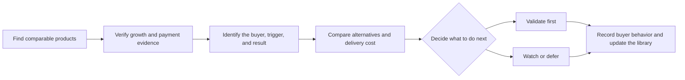

# SaaS Opportunity Research

**English** · [简体中文](README.zh-CN.md)

An Agent Skill for indie makers and small teams deciding which Web or SaaS opportunity deserves a test. Start from real products, identify who pays for a specific result, and compare the work against the founder's resources.

The workflow covers discovery, a deep dive on one opportunity, and portfolio review. It gives you a decision, the evidence that supports it, the strongest objection, and one inexpensive way to test the remaining uncertainty.

## Use the skill

1. Copy the complete [skill folder](skills/saas-opportunity-research/) into the skills directory supported by your client. For a Codex project, use `.agents/skills/saas-opportunity-research/`.
2. Invoke `$saas-opportunity-research`. If the client does not discover it, direct it to [SKILL.md](skills/saas-opportunity-research/SKILL.md#start-en).
3. Give the agent a market, your resources, candidate URLs or sources, and whether you want discovery, a deep dive, or a review.

> Use $saas-opportunity-research. I can build and operate a small browser SaaS alone. Find early examples of US bookkeeping tools with a specific recurring task. Show the strongest evidence, how buyers do the job now, and one test I can run before building.

Public research works with the tools your client already has. Optional sources and private dashboards depend on access. The [worked example](skills/saas-opportunity-research/references/playbook.en.md#example) shows how to decide with incomplete or conflicting evidence.

For broader product work after a decision, see [Web Product Workflow](https://github.com/RickZhang777/web-product-workflow). This research skill also works independently.

[MIT License](LICENSE)
