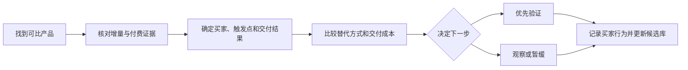

# Web 出海选品研究 Skill

[English](README.md) · **简体中文**

给独立开发者和小团队使用的 Agent Skill。它从已存在的产品出发，找出谁会为什么结果付费，再结合自己的资源判断哪个方向值得先试。

支持寻找新机会、深挖一个候选和复盘历史库。每次交付一个判断、能支撑判断的证据、最强反证，以及一个便宜的验证动作。

## 如何使用

1. 把完整的 [Skill 文件夹](skills/saas-opportunity-research/) 放到客户端支持的技能目录。Codex 项目可放到 `.agents/skills/saas-opportunity-research/`。
2. 调用 `$saas-opportunity-research`。客户端没有发现技能时，请它读取 [SKILL.md](skills/saas-opportunity-research/SKILL.md#start-zh)。
3. 说明目标市场、可投入资源、已知网站或资料，以及本轮是找机会、深挖还是复盘。

> 使用 $saas-opportunity-research。我能一个人开发和运营小型 Web SaaS。请找美国记账员反复遇到的具体任务，优先研究刚起势的同行。写出最强证据、客户现在的做法，以及开发前能做的一次验证。

可用现有工具做公开研究。商业数据源和账号内数据取决于实际权限。[完整示例](skills/saas-opportunity-research/references/playbook.zh-CN.md#example) 展示怎样在证据不齐或冲突时给出判断。

方向确定后，可用 [Web Product Workflow](https://github.com/RickZhang777/web-product-workflow) 继续产品定义和实施交接。本 Skill 可以单独使用。

[MIT 许可证](LICENSE)
